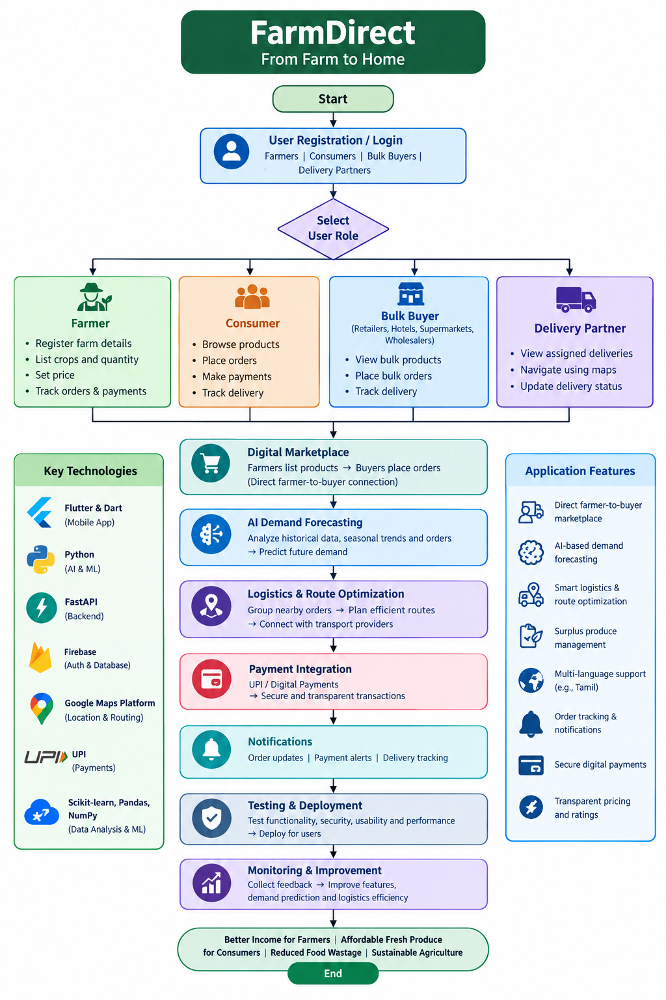

# Smart India Hackathon Workshop
# Date:26/10/2026
## Reference Number: 26019283
## Name: ROSUN.B

## Problem Title
SIH 26033: Multiple intermediaries reduce farmers earnings and increase consumer prices.

## Problem Creater's Organization
Ministry of Consumer Affairs, Food & Public Distribution

## Theme
Agriculture, FoodTech & Rural Development

## Problem Description
Expected Solution: Create a digital marketplace that:

• Connects farmers/FPOs directly with consumers and bulk buyers.
• Provides logistics support.
• Uses AI for demand forecasting and route optimization.

Benefits:

• Better prices for farmers.
• Lower prices for consumers.
• Reduced supply chain inefficiencies.

## Proposed Solution

 DETAILED EXPLANATION OF THE PROPOSED SOLUTION
1. Farmer Registration and Crop Listing
Farmers can register on the FarmDirect application using their mobile number and basic details. After registration, they can create a profile containing their location, farm details, and available agricultural products.

Farmers can upload crop photographs and provide information such as product name, quantity, quality, expected harvest date, and selling price. This information will be displayed on the marketplace so that buyers can easily find and purchase products directly from farmers.

Example: A farmer with 500 kg of tomatoes can list the available quantity and price on the application. Nearby consumers, vegetable shops, and hotels can view the listing and place orders.
2. Direct Connection Between Farmers and Buyers
The application provides a common platform where farmers and buyers can interact without depending entirely on middlemen. Consumers can purchase smaller quantities, while retailers, hotels, supermarkets, and wholesalers can place bulk orders.

Buyers can compare available products, prices, quantities, and delivery options before placing an order. Farmers can receive order notifications and accept or reject orders based on availability.

This system improves price transparency and allows farmers to reach more customers. It can also help buyers obtain fresh produce at competitive prices.
3. AI-Based Demand Forecasting
FarmDirect uses Artificial Intelligence (AI) and machine learning to estimate the future demand for agricultural products. The system analyzes available information such as previous sales, seasonal trends, current orders, and market prices to predict which products are likely to be in high demand.

Based on these predictions, the application can provide useful recommendations to farmers regarding the quantities they may want to supply and the crops that are experiencing increased demand.

Example: If the system predicts an increase in demand for tomatoes during the coming week, it can notify farmers and buyers about the expected demand. Farmers can use this information to plan harvesting and sales more effectively.

Demand forecasts will become more accurate as the application collects more reliable data. Predictions will be presented as guidance rather than guaranteed market outcomes.
4. Smart Logistics and Route Optimization
Transportation is a major challenge in agricultural supply chains because fresh produce must often be delivered quickly. FarmDirect includes a logistics module that connects farmers with delivery partners and transport providers.

The system can group orders from nearby farms and buyers to reduce unnecessary trips. Route optimization technology can recommend efficient delivery routes using factors such as distance, delivery locations, traffic information where available, and delivery deadlines.

Example: If three farmers in the same village receive orders from nearby shops, the application can help coordinate the collection of their produce and suggest a suitable delivery route. This can reduce fuel consumption, transportation costs, and delivery delays.
5. Order Management and Secure Payments
The application provides order tracking for farmers and buyers. Farmers can view new orders, confirm quantities, prepare products, and update order status. Buyers can track the progress of their purchases and receive notifications about delivery.

Digital payments can be integrated through a supported payment gateway or UPI-based payment service. The system can maintain transaction records to help farmers track their sales and payments.

Payment confirmation, cancellation, refunds, and delivery disputes should be handled through clearly defined procedures to improve trust between users.
6. Local Language Support and Notifications
To make the application accessible to farmers with different levels of digital literacy, FarmDirect can offer a simple interface with local-language support, including Tamil. Large buttons, clear icons, voice-assisted instructions, and step-by-step guidance can make the application easier to use.

Farmers can receive notifications about new orders, payment updates, changing demand, harvest schedules, and delivery arrangements. Buyers can receive updates about product availability and order status.
7. Surplus Produce Management and Waste Reduction
Farmers sometimes struggle to sell their entire harvest because of unpredictable demand or limited market access. FarmDirect can identify produce that remains unsold and notify nearby buyers about its availability.

The application can recommend discounts for products approaching their preferred selling deadline, subject to farmer approval. It can also connect farmers with suitable bulk buyers, food-processing businesses, or donation organizations where available.

This feature helps reduce post-harvest losses and ensures that more agricultural produce reaches consumers instead of being wasted.
2. HOW IT ADDRESSES THE PROBLEM
FarmDirect is a smart digital marketplace designed to solve the major challenges faced by farmers in selling their agricultural products. It connects farmers directly with consumers and bulk buyers, provides logistics support, and uses Artificial Intelligence (AI) to improve demand forecasting and delivery efficiency.
1. Eliminates Unnecessary Intermediaries
Problem: Farmers often depend on multiple intermediaries to sell their produce, reducing the income they receive.

Solution: FarmDirect allows farmers to list their crops directly on the application. Consumers, retailers, hotels, supermarkets, and wholesalers can purchase produce directly from farmers.

Result: Farmers can negotiate better prices, increase their profit margins, and access a wider customer base.
2. Reduces Prices for Consumers
Problem: Consumers often pay higher prices because of commissions and costs added at different stages of the supply chain.

Solution: The application connects consumers directly with farmers and displays product prices transparently. Buyers can compare products and choose suitable prices.

Result: Consumers can access fresh agricultural products at competitive prices while farmers receive a better share of the selling price.
3. Solves Transportation and Logistics Challenges
Problem: Farmers may face high transportation costs, delayed deliveries, and difficulties finding suitable transport for their produce.

Solution: FarmDirect connects farmers with transport providers and uses route optimization to plan efficient deliveries. Orders from nearby farms can be grouped to reduce unnecessary trips.

Result: Transportation costs and delivery delays can be reduced, improving the efficiency of agricultural distribution.
4. Prevents Food Wastage Through AI
Problem: Farmers sometimes experience unsold surplus produce because of unpredictable demand and limited market access.

Solution: AI-based demand forecasting analyzes historical sales, seasonal patterns, and available order data to estimate future demand. The application can notify farmers about demand trends and help them connect with additional buyers for surplus produce.

Result: Farmers can make better selling decisions, improve supply planning, and reduce avoidable food wastage.
5. Improves Market Access for Farmers
Problem: Small-scale farmers may have limited access to large markets and bulk buyers.

Solution: FarmDirect provides a common digital platform where farmers and Farmer Producer Organizations (FPOs) can display their products to individual consumers, retailers, hotels, and supermarkets.

Result: Farmers can reach more customers, find bulk purchasing opportunities, and expand their market beyond their immediate local area.
6. Improves Transparency and Trust
Problem: Farmers and buyers may face uncertainty regarding product quality, pricing, order status, and payments.

Solution: The application provides clear product listings, order tracking, digital transaction records, and buyer feedback.
3. INNOVATION AND UNIQUENESS OF THE SOLUTION
FarmDirect – From Farm to Home is an innovative digital marketplace that combines direct agricultural trading, Artificial Intelligence (AI), and smart logistics in a single mobile application. Unlike traditional agricultural marketing systems, FarmDirect aims to help farmers sell their produce directly to consumers and bulk buyers while improving demand planning and delivery efficiency.
1. Direct Farmer-to-Buyer Marketplace
FarmDirect reduces dependence on multiple intermediaries by connecting farmers and Farmer Producer Organizations (FPOs) directly with consumers, retailers, hotels, supermarkets, and wholesalers. This creates a more transparent trading environment where farmers can set their prices and buyers can compare products.
2. AI-Based Demand Forecasting
The application uses AI and machine learning to analyze historical sales, seasonal trends, and current orders to estimate future demand for agricultural products. It provides recommendations to farmers about expected demand and potential selling opportunities, helping them plan their supply more effectively.
3. Smart Logistics and Route Optimization
FarmDirect integrates logistics support into the marketplace. It can group orders from nearby farms and recommend efficient delivery routes based on distance, delivery locations, and available traffic information. This helps reduce unnecessary trips, fuel consumption, and transportation costs.
4. Surplus Produce Management
A unique feature of FarmDirect is its ability to help farmers find buyers for unsold agricultural produce. The application can notify nearby buyers about surplus stock and allow farmers to offer discounts when appropriate. This helps reduce avoidable food wastage and recover income from produce that might otherwise remain unsold.
5. Local Language and Voice Assistance
The application can support regional languages such as Tamil and provide voice-assisted navigation. This makes digital agricultural services more accessible to farmers who may have limited technical knowledge or difficulty using English-language applications.
6. Unified Agricultural Platform
Instead of requiring farmers to use separate services for selling crops, finding buyers, arranging transport, and tracking orders, FarmDirect brings these functions together in one application. This integrated approach simplifies the agricultural selling process.
7. Data-Driven Decision Making
FarmDirect can provide farmers with simple reports on sales, customer demand, product prices, and order history. These insights help farmers make more informed decisions about harvesting, pricing, and marketing their produce.

## Technical Approach

1. TECHNNOLOGIES TO BE USED
 AI and Machine Learning Technologies
- Machine Learning: Predict demand for agricultural products using historical sales, seasonal patterns, and order data.
- Pandas and NumPy: Process and analyze agricultural market data.
- Scikit-learn: Build and evaluate demand forecasting models.
- Route Optimization Algorithms: Identify efficient delivery routes and coordinate deliveries from nearby farms.
 Hardware Requirements
Hardware	Purpose
Smartphone	Used by farmers and buyers to access the application.
Computer or laptop	Used by developers to build and test the application.
Internet connection	Enables product listings, orders, payments, and data synchronization.
GPS-enabled device	Helps identify farm locations and delivery destinations.

No specialized agricultural hardware is required for the initial version. Existing smartphones and cloud services are sufficient to develop and demonstrate the prototype.
4. Payment and Security Technologies
- UPI payment gateway: Supports digital payments between buyers and the marketplace.
- Authentication and access control: Restricts access to authorized user accounts and data.
- HTTPS encryption: Protects information transmitted between the mobile app and backend.
- Database security rules: Help prevent unauthorized access to farmer, buyer, and order information.
Payment integration can be added after the basic marketplace is functional.
3. Technology	  Purpose
FarmDirect is a smart agricultural marketplace application that connects farmers directly with consumers and bulk buyers. The application uses mobile app development, database management, Artificial Intelligence (AI), and logistics technologies to improve agricultural trading and delivery.
4.  Technology	                                   Purpose
Flutter	                            Develop an Android and iOS mobile application.
Dart	                              Programming language used to build the Flutter application.
Python	                            Develop AI models for demand forecasting and data analysis.
FastAPI            	                Connect the mobile application with the backend services.
Firebase                            Authentication	Provide secure user registration and login.
Cloud                               Firestore	Store farmer profiles, crop details, and order information.
Google Maps Platform                Display locations and support delivery route planning.
Firebase Cloud Messaging (FCM)    	Send notifications about new orders, payments, and deliveries. 

Methodology and Process for Implementation – FarmDirect
FarmDirect will be developed through the following steps:

1. Requirement Analysis: Identify the needs of farmers, consumers, bulk buyers, and delivery partners.

2. UI/UX Design: Design a simple, user-friendly interface with farmer registration, product listings, ordering, and delivery tracking.

3. Application Development: Develop the mobile application using Flutter and Dart, with Firebase for user authentication and database management.

4. Digital Marketplace Integration: Enable farmers to upload crop details, set prices, and receive orders directly from consumers and bulk buyers.

5. AI Demand Forecasting: Use Python and machine learning to analyze historical sales and seasonal trends to predict demand for agricultural products.

6. Logistics and Route Optimization: Integrate mapping services to identify delivery locations and optimize routes for efficient transportation.

7. Payment and Notification Integration: Implement digital payment options and notifications for orders, payments, and delivery updates.

8. Testing and Deployment: Test the application for functionality, security, usability, and performance before deploying it for farmers and buyers.

9. Monitoring and Improvement: Collect user feedback and improve demand predictions, logistics efficiency, and application features over time.

## Feasibility and Viability
Analysis of the Feasibility of the Idea – FarmDirect: From Farm to Home
The FarmDirect application is feasible because it uses existing technologies to connect farmers directly with consumers and bulk buyers. It aims to reduce intermediaries, improve farmers’ income, provide fresh produce at affordable prices, and minimize food wastage.

1. Technical Feasibility
The application can be developed using technologies such as Flutter, Python, Firebase, FastAPI, and Google Maps Platform. AI-based demand forecasting and route optimization can help predict demand and improve delivery efficiency. These technologies are suitable for developing and maintaining the application.
2. Economic Feasibility
The project can be developed initially with a limited budget using free or low-cost development tools and cloud services. Revenue can be generated through small transaction fees, delivery charges, or subscriptions for bulk buyers. Starting in a limited geographical area can help reduce initial costs.
3. Operational Feasibility
The application is easy to use for farmers, consumers, bulk buyers, and delivery partners. Features such as local-language support, simple product listings, digital payments, and order tracking can improve usability. Training and customer support may be required for farmers who are unfamiliar with digital platforms.
4. Market Feasibility
There is a potential market for FarmDirect because consumers seek fresh and affordable agricultural products, while farmers need better market access and fair prices. Retailers, hotels, restaurants, and supermarkets can also use the platform to purchase products in bulk.
5. Social and Environmental Feasibility
FarmDirect can support rural development by improving farmers’ earning opportunities and connecting them with more buyers. Efficient transportation, demand prediction, and surplus produce management can help reduce food wastage and unnecessary fuel consumption.

Potential Challenges and Risks – FarmDirect: From Farm to Home
The FarmDirect application aims to connect farmers directly with consumers and bulk buyers. However, certain challenges and risks may arise during its development and implementation.
1. Technical Challenges
Developing and maintaining the application may involve technical difficulties, such as server failures, software bugs, and network connectivity issues.

Solution: Use reliable cloud services, conduct regular testing, and provide timely maintenance.
2. Digital Literacy
Some farmers may have limited experience using smartphones and digital applications.

Solution: Provide a simple user interface, Tamil-language support, voice assistance, and basic user training.
3. Logistics and Transportation
Delivering fresh agricultural products on time can be difficult because of traffic, long distances, and a lack of suitable transportation.

Solution: Use route optimization, local delivery partners, and efficient delivery scheduling.
4. Price Fluctuations
Agricultural prices may change due to seasonal variations, weather conditions, and market demand.

Solution: Provide updated market information and transparent pricing to help farmers and buyers make informed decisions.
5. Product Quality and Food Wastage
Products may be damaged or spoiled during storage and transportation, leading to financial losses.

Solution: Implement quality checks, proper packaging, quick delivery, and surplus produce management.
6. Security and Privacy Risks
The application may handle personal information, addresses, order details, and payment-related data.

Solution: Use secure authentication, encrypted communication, access controls, and trusted payment gateways.
7. Financial Risks
Initial development, marketing, transportation, and maintenance costs may be high. The platform may also take time to generate revenue.

Solution: Start with a small pilot project, control operational costs, and expand gradually based on demand.
8. Trust and Adoption
Farmers and consumers may hesitate to use a new platform due to concerns about payment reliability, product quality, or delivery services.

Solution: Verify user profiles, provide ratings and reviews, ensure transparent transactions, and offer customer support.
9. Internet Connectivity
Poor internet connectivity in rural areas may prevent farmers from listing products or managing orders efficiently.

Solution: Optimize the application for low-bandwidth networks and provide simple interfaces with minimal data usage.
10. Demand Forecasting Errors
AI-based demand predictions may be inaccurate because of unexpected weather changes, seasonal conditions, or sudden changes in customer demand.

Solution: Regularly update the prediction model using available data and allow farmers to make final decisions based on their own experience.

## Impact and Benefits

Potential Impact on Target Audience – FarmDirect
FarmDirect is expected to create a positive impact on farmers, consumers, bulk buyers, and delivery partners by improving agricultural marketing, reducing supply chain costs, and minimizing food wastage.
1. Farmers
- Increased income: Direct selling helps farmers reduce dependence on intermediaries and improve their earning opportunities.
- Wider market access: Farmers can reach consumers, retailers, hotels, supermarkets, and wholesalers.
- Better decision-making: AI-based demand forecasting helps farmers plan their supply based on expected market demand.
- Reduced wastage: The application helps farmers find buyers for surplus agricultural produce.
2. Consumers
- Affordable prices: Direct purchasing can reduce additional costs associated with multiple intermediaries.
- Fresh produce: Improved coordination between farmers and buyers can support faster delivery of agricultural products.
- Price transparency: Consumers can compare product prices and available quantities before purchasing.
3. Bulk Buyers
- Easy procurement: Hotels, restaurants, retailers, and supermarkets can purchase agricultural products directly from farmers.
- Reliable supply planning: Order information and demand forecasts can help buyers plan their purchases.
- Reduced procurement costs: Bulk ordering and coordinated transportation can reduce purchasing and logistics expenses.
4. Delivery Partners
- More business opportunities: The platform can connect transport providers with farmers and buyers who need delivery services.
- Efficient transportation: Route optimization and grouped orders can help reduce unnecessary trips and fuel consumption.
5. Society and the Environment
- Reduced food wastage: Better demand planning and surplus produce management can help prevent avoidable losses.
- Lower fuel consumption: Efficient delivery routes can reduce unnecessary travel.
- Improved rural development: Digital market access can support small-scale farmers and strengthen local agricultural businesses.
Benefits of the Solution – FarmDirect
FarmDirect provides social, economic, and environmental benefits by connecting farmers directly with consumers and bulk buyers through a digital marketplace supported by AI-based demand forecasting and smart logistics.
1. Economic Benefits
- Higher income for farmers: Reduces dependence on intermediaries and creates opportunities for better selling prices.
- Lower prices for consumers: Direct purchasing can reduce additional supply chain costs.
- Reduced transportation expenses: Route optimization and grouped deliveries help minimize unnecessary travel.
- Increased market opportunities: Farmers can sell their products to retailers, hotels, supermarkets, and wholesalers.
- Improved business efficiency: Demand forecasts help farmers and buyers plan purchases and sales more effectively.
2. Social Benefits
- Support for small-scale farmers: Provides access to a wider market through a single digital platform.
- Digital inclusion: Local-language support and a simple interface make online agricultural services more accessible.
- Better farmer–buyer relationships: Direct communication improves transparency and trust.
- Rural development: Encourages the adoption of digital technology in agriculture and creates opportunities for local delivery partners.
- Access to fresh food: Helps consumers find fresh agricultural products from local farmers.
3. Environmental Benefits
- Reduced food wastage: AI-based demand forecasting and surplus produce management help reduce unsold agricultural products.
- Lower fuel consumption: Efficient delivery routes reduce unnecessary vehicle travel.
- Reduced carbon emissions: Fewer unnecessary trips can help lower transportation-related emissions.
- Efficient resource utilization: Better demand planning helps align the supply of produce with market requirements.
- Promotion of local supply chains: Connecting nearby farmers and buyers can reduce unnecessary transportation distances.
4. Technological Benefits
- AI-powered decision-making: Provides demand predictions and market insights to support better planning.
- Real-time updates: Keeps farmers and buyers informed about orders, payments, and deliveries.
- Transparent transactions: Digital records help users track orders and sales.
- Scalable platform: The application can expand to support more farmers, crops, buyers, and locations over time.

## Research and References

1. e-NAM – National Agriculture Market
https://enam.gov.in/

2. FAO – Food and Agriculture Organization
https://www.fao.org/

3. Google OR-Tools – Route Optimization
https://developers.google.com/optimization/routing

4. Scikit-learn – Machine Learning
https://scikit-learn.org/stable/

5. Google Maps Platform
https://developers.google.com/maps
